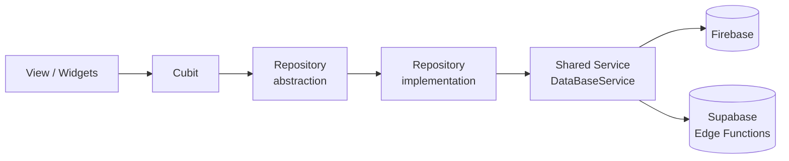

<div align="center">

# Sintir Admin Panel

**A responsive Flutter Web dashboard for managing users, courses, support tickets and analytics of the Sintir learning platform.**


[**Live Demo**](https://sintir-2f0be.web.app/) · [Features](#-features) · [Architecture](#-architecture) · [Getting Started](#-getting-started)

<div align="center">


# Sintir Admin Panel

</div>

---

## 📖 Overview

Sintir is an educational platform with student and teacher mobile apps. **Sintir Admin Panel** is the web back office used by the team to run it day to day:

- Monitor revenue, users and course performance from one dashboard.
- Manage users and courses with search, filters and pagination.
- Handle support tickets and reply to users in a chat view.
- Control who can do what through **role-based access control (RBAC)**.

The panel is fully responsive, supports **light and dark themes**, and ships with **Arabic and English** localization.

> Related project: [Sintir mobile app](https://github.com/Ziad-Gamal12/Sintir)

---

## ✨ Features

| Module | What it does |
| --- | --- |
| **Authentication** | Sign in, sign up and password reset with Firebase Auth; session-aware routing. |
| **Dashboard** | Summary cards, revenue, gender and course analytics charts. |
| **Courses Management** | Responsive course list with filtering. |
| **Course Details** | Sections and content, reports, feedback, subscribers, transactions, analytics and course actions. |
| **Content Creator Profile** | Instructor profile and their courses. |
| **Users Management** | Searchable, filterable, paginated user list (role, status, gender). |
| **User Details** | Profile, edit and actions, activity, wallet and transactions. |
| **Support** | Ticket list, ticket analytics and support chat. |
| **Teacher payouts & video pipeline** | Supabase Edge Functions for Mux video uploads/playback tokens and Paymob teacher withdrawals. |

---

## 📸 Screenshots

<!-- Put images in docs/screenshots/ and update the file names below -->

| Light | Dark |
| --- | --- |
|  |  |
|  |  |
|  |  |

---

## 🛠 Tech Stack

| Area | Tools |
| --- | --- |
| Framework | Flutter (Web), Dart `^3.10.4` |
| State management | `flutter_bloc`, `bloc`, `hydrated_bloc` |
| Dependency injection | `get_it` |
| Routing | `go_router` |
| Backend | Firebase Auth, Cloud Firestore, Firebase Storage |
| Serverless | Supabase Edge Functions |
| Video & payments | Mux (video), Paymob (payouts) |
| Networking | `dio` |
| Local storage | `hive_flutter`, `flutter_secure_storage`, HydratedBloc storage |
| UI | `fl_chart`, `data_table_2`, `skeletonizer`, `flutter_animate`, `cached_network_image` |
| Localization | `flutter_localizations`, `intl` (ARB files) |
| Functional utilities | `dartz`, `equatable` |

---

## 🏗 Architecture

The project follows a **feature-first structure** with **MVVM** and Cubits, using repository abstractions over shared services.



**Example: Users Management**

1. `UsersManagementViewBody` checks `Permission.viewUsers` for the signed-in user.
2. It provides `UsersManagementCubit`, which gets `UsersRepo` from GetIt.
3. The Cubit calls `getUsers()` with the current filters and page.
4. `UsersRepoImpl` builds a Firestore query on `Users` (ordered by `joinedDate`, 10 per page, optional role/status/gender filters).
5. `DataBaseService` (implemented by `FirebaseFirestoreservice`) runs the query and the result is mapped to `UserEntity`.

### Folder structure

```text
lib/
├── Core/
│   ├── Entities/       # Shared entities
│   ├── Errors/         # Failures and exceptions
│   ├── Helper/
│   ├── Managers/       # Shared cubits (e.g. theme)
│   ├── Models/
│   ├── Permissions/    # RBAC roles and permission mapping
│   ├── Services/       # Service abstractions + implementations, GetIt setup
│   ├── Themes/         # Light / dark themes
│   ├── Utils/          # GoRouter setup
│   ├── repos/
│   └── widgets/        # Reusable widgets
├── Features/
│   ├── Auth/
│   ├── ContentCreatorProfile/
│   ├── CourseDetails/
│   ├── CoursesManagment/
│   ├── Dashboard/
│   ├── Splash/
│   ├── Support/
│   ├── UserDetails/
│   └── UsersManagement/
├── generated/          # Generated localization code
├── l10n/               # intl_en.arb, intl_ar.arb
├── constant.dart
├── firebase_options.dart
└── main.dart
supabase/
└── functions/          # Edge Functions (Mux, Paymob, ...)
```

---

## 🔐 Roles & Permissions

Roles and account status are stored in the Firestore `Users` collection. A permission check requires the account to be **Active**.

| Role | Permissions |
| --- | --- |
| **Admin** | Everything |
| **CoursesManager** | View, publish, edit and delete courses |
| **UsersManager** | View, edit and delete users |
| **Support** | View and reply to tickets, change ticket status, ban users |
| **Viewer** (fallback) | View users, tickets, courses and analytics |

Declared permissions: `viewUsers`, `createUser`, `editUser`, `deleteUser`, `banUser`, `viewCourses`, `createCourse`, `editCourse`, `deleteCourse`, `publishCourse`, `viewTickets`, `replyTickets`, `changeTicketStatus`, `viewAnalytics`, `exportData`.

GoRouter redirects unauthenticated or inactive users to sign-in; module-level permissions are enforced in each feature's UI (hidden actions / access-denied view).

---

## ☁️ Backend

**Firestore** collections: `Users`, `Teachers`, `Students`, `Transactions`, `Courses`, `Tickets`, plus nested collections such as `Sections`, `Items`, `Reports`, `Feedbacks`, `Coupons`, `Subscribers`, `Favorites`, `Messages`.

**Supabase Edge Functions** (`supabase/functions`):

| Function | Purpose |
| --- | --- |
| `create-video-upload` | Authorizes a teacher, creates a Mux direct-upload session and stores video metadata |
| `resume-video-upload` | Checks whether an interrupted upload can be resumed |
| `cancel-video-upload` | Cancels a pending upload and updates the video record |
| `get-video-playback-token` | Verifies access and issues a signed Mux playback token |
| `mux-webhook` | Verifies Mux signatures and updates video processing status |
| `teacher-withdrawal` | Reserves and processes a teacher payout through Paymob |

More details on the video pipeline: [`MUX_VIDEO.md`](MUX_VIDEO.md).

---

## 🚀 Getting Started

### Prerequisites

- [Flutter SDK](https://docs.flutter.dev/get-started/install) with Dart `3.10.4` or newer
- A Firebase project (Auth + Firestore) and a Supabase project
- [Firebase CLI](https://firebase.google.com/docs/cli) (for hosting) and [Supabase CLI](https://supabase.com/docs/guides/cli) (for Edge Functions)

### Run locally

```bash
git clone https://github.com/<your-username>/Sintir_DashBoard.git
cd Sintir_DashBoard
flutter pub get
flutter run -d chrome
```

### Configure

1. **Firebase**: generate `lib/firebase_options.dart` for your own project (for example with `flutterfire configure`).
2. **Supabase**: set your project URL and public (anon) key in `lib/constant.dart` (`supaBaseUrl`, `supaAnonKey`).
3. **Edge Function secrets**: copy `supabase/functions/.env.example` to `supabase/functions/.env` and fill in the values:

   ```text
   FB_PROJECT_ID, FB_CLIENT_EMAIL, FB_PRIVATE_KEY
   PAYMOB_PAYOUT_CLIENT_ID, PAYMOB_PAYOUT_CLIENT_SECRET,
   PAYMOB_PAYOUT_USERNAME, PAYMOB_PAYOUT_PASSWORD, PAYMOB_WEBHOOK_HMAC_SECRET
   MUX_TOKEN_ID, MUX_TOKEN_SECRET, MUX_WEBHOOK_SECRET,
   MUX_SIGNING_KEY_ID, MUX_SIGNING_KEY_PRIVATE_BASE64
   ```

   > Never commit real secrets. Only the public (anon) Supabase key belongs in the client.

4. **Edge Functions** (optional, local):

   ```bash
   supabase functions serve --env-file supabase/functions/.env
   supabase functions deploy <function-name> --no-verify-jwt
   ```

### Build & deploy

```bash
flutter build web
firebase deploy --only hosting   # serves build/web with an SPA rewrite
```

`vercel.json` is also included, so the web build can be hosted on Vercel with an SPA rewrite to `index.html`.

---

## 🎨 Theming & Localization

- **Font:** Cairo
- **Colors:** primary `#4169E2`, secondary `#FF8C1A`
- **Themes:** light and dark, persisted with `HydratedBloc`
- **Languages:** Arabic and English (ARB files in `lib/l10n`)

---

## 🗺 Roadmap

- [ ] Unit and widget tests for cubits, repositories and permission mapping
- [ ] CI workflow (analyze + test + build web)
- [ ] Firestore security rules tracked in the repo
- [ ] Enforce module permissions at the router level

---

## 👤 Author

**Ziad** · Flutter Developer

[LinkedIn](#) · [GitHub](#) · [Email](#) <!-- add your links -->

---

## 📄 License

<!-- Add a LICENSE file (e.g. MIT) and update this line. -->
