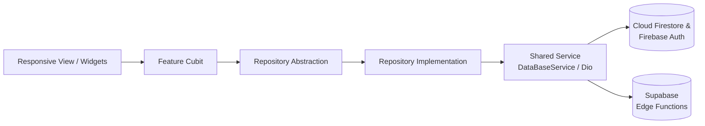

&lt;div align=&quot;center&quot;&gt;

&lt;img src=&quot;assets/Icons/SVG_Icons/AppLogo.svg&quot; alt=&quot;Sintir Admin Panel Logo&quot; width=&quot;96&quot; /&gt;

# Sintir Admin Panel

**A responsive Flutter Web back-office platform for managing users, courses, support operations, payouts, and real-time analytics across the Sintir educational ecosystem.**


[Live Demo](https://www.google.com/search?q=https%3A%2F%2Fsintir-2f0be.web.app%2F) · [Companion Mobile App Repo](https://www.google.com/search?q=https%3A%2F%2Fgithub.com%2FZiad-Gamal12%2FSintir)

&lt;/div&gt;

## 📖 Overview

**Sintir Admin Panel** (`sintir_dashboard`) is the administrative control center for the [Sintir digital learning platform](https://www.google.com/search?q=https%3A%2F%2Fgithub.com%2FZiad-Gamal12%2FSintir). Built with Flutter Web, it empowers operations teams, course managers, and support staff to oversee platform activity from a single responsive interface:

- **Executive Analytics & KPIs:** Monitor platform revenue, user demographics, enrollment trends, and course performance through interactive charts (`fl_chart`).
- **Granular Role-Based Access Control (RBAC):** Enforce database-driven permissions across 5 distinct operational roles (`Admin`, `CoursesManager`, `UsersManager`, `Support`, and `Viewer`) with active-status verification.
- **Course & Instructor Governance:** Review, filter, publish, edit, or remove courses, inspect section content, moderate student reports, and audit course transactions.
- **User & Wallet Operations:** Search and filter users with server-side pagination, inspect individual wallets and transaction histories, and manage account statuses.
- **Real-Time Support Desk:** Triage support tickets, track resolution analytics, and communicate directly with students and teachers in a dedicated support chat interface.
- **Serverless Media & Payout Backend:** Houses the **Supabase Edge Functions** powering **Mux** direct video uploads/signed playback tokens and **Paymob** instructor withdrawals.

## 📸 Screenshots

| Light Mode | Dark Mode |
| :---: | :---: |
| &lt;img src=&quot;docs/screenshots/dashboard-light.png&quot; alt=&quot;Dashboard Light Mode&quot; width=&quot;420&quot; /&gt; | &lt;img src=&quot;docs/screenshots/dashboard-dark.png&quot; alt=&quot;Dashboard Dark Mode&quot; width=&quot;420&quot; /&gt; |
| &lt;img src=&quot;docs/screenshots/users-light.png&quot; alt=&quot;Users Management Light Mode&quot; width=&quot;420&quot; /&gt; | &lt;img src=&quot;docs/screenshots/users-dark.png&quot; alt=&quot;Users Management Dark Mode&quot; width=&quot;420&quot; /&gt; |
| &lt;img src=&quot;docs/screenshots/course-details-light.png&quot; alt=&quot;Course Details Light Mode&quot; width=&quot;420&quot; /&gt; | &lt;img src=&quot;docs/screenshots/support-dark.png&quot; alt=&quot;Support Chat Dark Mode&quot; width=&quot;420&quot; /&gt; |

## ✨ Features by Module

| Module | Key Capabilities |
| :--- | :--- |
| **Authentication (`Auth`)** | Email/password sign-in, staff registration, password reset via Firebase Auth, and session-aware route redirection. |
| **Analytics Overview (`Dashboard`)** | Responsive KPI summary cards, revenue trajectories, gender distribution breakdowns, and course analytics charts. |
| **Courses Management (`CoursesManagment`)** | Searchable, filterable, responsive course directory with status badges and quick moderation actions. |
| **Course Deep-Dive (`CourseDetails`)** | Full inspection of course sections, lecture items, student reports, reviews/feedback, subscribers, coupons, and financial transactions. |
| **Creator Profile (`ContentCreatorProfile`)** | Instructor profile overview, teaching portfolio, and associated course metrics. |
| **Users Management (`UsersManagement`)** | Paginated Firestore directory (`10` records per page, ordered by `joinedDate`) with multi-criteria filtering by role, account status, and gender. |
| **User Profile & Wallet (`UserDetails`)** | Detailed user inspection, profile editing, role/status updates, activity logs, wallet balance monitoring, and transaction history. |
| **Support Center (`Support`)** | Ticket queue management, ticket volume analytics, status updates, and real-time support chat messaging. |
| **Serverless Pipeline (`supabase/functions`)** | Deno/TypeScript Edge Functions orchestrating Mux video uploads, webhook verification, signed playback tokens, and Paymob teacher payouts. |

## 🔐 Role-Based Access Control (RBAC) & Routing

User roles and account statuses are stored in the Firestore `Users` collection and evaluated locally via `lib/Core/Permissions/Permissions Mapping.dart`. Every permission check requires the user's account status to be **`Active`**.

### Role Matrix

| Role | Granted Permissions |
| :--- | :--- |
| **Admin** | Full superuser access across all modules and actions (bypasses individual permission checks). |
| **CoursesManager** | `viewCourses`, `publishCourse`, `editCourse`, `deleteCourse` |
| **UsersManager** | `viewUsers`, `editUser`, `deleteUser` |
| **Support** | `viewTickets`, `replyTickets`, `changeTicketStatus`, `banUser` |
| **Viewer** *(Default fallback)* | `viewUsers`, `viewTickets`, `viewCourses`, `viewAnalytics` |

**Complete Declared Permission Set (`15` granular flags):**
`viewUsers`, `createUser`, `editUser`, `deleteUser`, `banUser`, `viewCourses`, `createCourse`, `editCourse`, `deleteCourse`, `publishCourse`, `viewTickets`, `replyTickets`, `changeTicketStatus`, `viewAnalytics`, `exportData`.

### Declarative Routing (`GoRouter`)

Configured in `lib/Core/Utils/App_router.dart`, the router enforces active session checks before rendering protected views, while individual feature views enforce module-level permissions (rendering `AccessDeniedWidget` or hiding restricted actions):

| Route Path | Screen | Access & State Handling |
| :--- | :--- | :--- |
| `/` | `SplashView` | Public entry; routes based on cached session state |
| `/SignInView` | `SignInView` | Public; redirects authenticated active sessions to `/dashboard` |
| `/signUpView` | `SignUpView` | Public staff/user registration |
| `/teacherResetPasswordView` | `CustomResetPasswordView` | Public password recovery flow |
| `/dashboard` | `ResponsiveDashboardView` | Requires active authenticated session (`UID` + `Active` status) |
| `/courses-managment` | `ResponsiveCoursesManagmentView` | Session guard + UI-level `Permission.viewCourses` check |
| `/responsive_course_details_view` | `ResponsiveCourseDeatilsView` | Session guard; receives course object via `state.extra` |
| `/ContentCreatorProfile` | `ContentCreatorProfile` | Session guard; receives creator entity via `state.extra` |
| `/ResponsiveUsersManagementView` | `ResponsiveUsersManagementView` | Session guard + UI-level `Permission.viewUsers` check |
| `/responsive-user-details` | `ResponsiveUserDetailsView` | Session guard; receives target `UID` via `state.extra` |
| `/ResponsiveTicketsManagementView` | `ResponsiveTicketsManagementView` | Session guard + UI-level `Permission.viewTickets` check |
| `/SupportChatView` | `ResponsiveSupportChatView` | Session guard; receives ticket entity via `state.extra` |
| `/unauthorized` | `UnauthorizedView` | Displayed when session or access requirements fail |

## 🛠 Tech Stack

| Layer | Packages & Tools |
| :--- | :--- |
| **Framework & SDK** | Flutter (Web, Windows, macOS, Android, iOS), Dart `^3.10.4` |
| **State Management** | `flutter_bloc ^9.1.1`, `bloc ^9.1.0`, `hydrated_bloc ^11.0.0`, `provider ^6.1.5+1` |
| **Dependency Injection** | `get_it ^9.2.0` |
| **Routing** | `go_router ^17.0.1` |
| **Backend & Cloud** | `firebase_core ^4.3.0`, `firebase_auth ^6.1.3`, `cloud_firestore ^6.1.1`, `firebase_storage ^13.0.5`, `supabase_flutter ^2.12.0` |
| **Networking** | `dio ^5.9.0` |
| **Data Visualization & Tables** | `fl_chart ^1.1.1`, `data_table_2 ^3.0.0` |
| **UI, Icons & Animations** | `flutter_animate ^4.5.2`, `skeletonizer ^2.1.2`, `loading_animation_widget ^1.3.0`, `cached_network_image ^3.4.1`, `lucide_icons_flutter ^3.1.15`, `font_awesome_flutter ^11.0.0`, `svg_flutter ^0.0.1` |
| **Security & Local Storage** | `flutter_secure_storage ^11.0.0`, `hive_flutter ^1.1.0`, `secure_content ^2.0.0`, `device_info_plus ^13.2.0` |
| **Localization** | `flutter_localizations`, `intl` (Arabic & English ARB files) |
| **Functional & Utilities** | `dartz ^0.10.1`, `equatable`, `uuid`, `image_picker ^1.2.1`, `path_provider ^2.1.5` |

## 🏗 Architecture

The project follows a **feature-first MVVM / Clean Architecture** pattern powered by **BLoC/Cubit** and **Repository abstractions**. Shared services and repositories are registered in `lib/Core/Services/get_it_Service.dart` after `main.dart` initializes Firebase, Supabase, Hive, and `HydratedBloc` storage.



### Example Workflow: Paginated Users Management
1. **Permission Check:** `UsersManagementViewBody` reads the locally cached user profile and verifies `Permission.viewUsers`.
2. **DI & State Provision:** If authorized, it provides `UsersManagementCubit` injected with `getIt<UsersRepo>()`.
3. **Query Execution:** The Cubit invokes `UsersRepo.getUsers()` with the active search query, role/status/gender filters, and pagination cursor.
4. **Firestore Mapping:** `UsersRepoImpl` constructs a query on the `Users` collection (ordered by `joinedDate`, page size `10`) and calls `DataBaseService.getData()` (`FirebaseFirestoreservice`), mapping documents into `UserEntity` objects.

### Folder Structure

```text
lib/
├── Core/
│   ├── Entities/          # Shared domain entities
│   ├── Errors/            # Custom Failure classes and error handlers
│   ├── Helper/            # Responsive layout helpers and UI utilities
│   ├── Managers/          # App-wide Cubits (e.g., ThemeCubit)
│   ├── Models/            # Shared data models
│   ├── Permissions/       # RBAC roles and permission mapping logic
│   ├── Services/          # Firebase, Supabase, Dio, and GetIt registration
│   ├── Themes/            # Light and Dark theme configurations (app_theme.dart)
│   ├── Utils/             # GoRouter configuration (App_router.dart) and constants
│   ├── repos/             # Shared repository contracts and implementations
│   └── widgets/           # Reusable dashboard tables, cards, and access-denied views
├── Features/
│   ├── Auth/
│   ├── ContentCreatorProfile/
│   ├── CourseDetails/
│   ├── CoursesManagment/
│   ├── Dashboard/
│   ├── Splash/
│   ├── Support/
│   ├── UserDetails/
│   └── UsersManagement/
├── generated/             # Auto-generated localization classes
├── l10n/                  # intl_ar.arb and intl_en.arb translation sources
├── constant.dart          # Brand colors, version, and public Supabase config
├── firebase_options.dart  # Platform-specific Firebase configuration
└── main.dart              # Application bootstrap
supabase/
└── functions/             # Serverless Edge Functions (Mux video & Paymob payouts)
```

## ☁️ Backend & Serverless Infrastructure

### Cloud Firestore Schema
- **Top-Level Collections:** `Users`, `Teachers`, `Students`, `Transactions`, `Courses`, `Tickets`, `MuxVideoIndex`, `MuxWebhookEvents`
- **Nested Collections:** `Sections`, `Items`, `Reports`, `Feedbacks`, `Coupons`, `Subscribers`, `JoinedBy`, `Results`, `MyResults`, `MyMistakes`, `Favorites`, `VideoNotes`, and `Messages`

### Supabase Edge Functions (`supabase/functions`)

| Edge Function | Purpose |
| :--- | :--- |
| `create-video-upload` | Verifies teacher identity, creates a **Mux** direct-upload session, and records video metadata in Firestore |
| `resume-video-upload` | Checks whether an interrupted Mux upload session remains resumable |
| `cancel-video-upload` | Cancels a pending upload or Mux asset and updates the corresponding Firestore record |
| `get-video-playback-token` | Validates course access and issues a signed JWT playback token for Mux video streaming |
| `mux-webhook` | Verifies Mux webhook signatures and updates Firestore video processing states in real time |
| `teacher-withdrawal` | Reserves and executes instructor wallet payouts via **Paymob** with reconciliation support |
| `sintir-analytics` | Aggregates platform analytics queried by the dashboard via `Dio` |

For detailed documentation on the video streaming and webhook architecture, see [MUX\_VIDEO.md](https://www.google.com/search?q=MUX_VIDEO.md).

## 🎨 Theming & Localization

- **Typography:** Uses the **Cairo** typeface (`Regular`, `Medium`, `SemiBold`, `Bold`) for crisp Arabic and English legibility.
- **Brand Palette:** Primary Royal Blue (`#4169E2`) and Secondary Vibrant Orange (`#FF8C1A`), with custom Light and Dark surface tokens defined in `lib/Core/Themes/app_theme.dart`.
- **Persistent Theme State:** `ThemeCubit` defaults to Dark Mode and persists user preference across browser sessions using `HydratedBloc`.
- **Bilingual Support:** Includes Arabic (`lib/l10n/intl_ar.arb`) and English (`lib/l10n/intl_en.arb`) localization files with generated delegates under `lib/generated/`.

## 🚀 Getting Started

### Prerequisites
- [Flutter SDK](https://www.google.com/search?q=https%3A%2F%2Fdocs.flutter.dev%2Fget-started%2Finstall) with Dart `^3.10.4`
- A **Firebase** project (Authentication, Cloud Firestore, Storage, Hosting)
- A **Supabase** project + [Supabase CLI](https://www.google.com/search?q=https%3A%2F%2Fsupabase.com%2Fdocs%2Fguides%2Fcli) (for Edge Functions)
- [Firebase CLI](https://www.google.com/search?q=https%3A%2F%2Ffirebase.google.com%2Fdocs%2Fcli) or [Vercel CLI](https://www.google.com/search?q=https%3A%2F%2Fvercel.com%2Fdocs%2Fcli) (for web deployment)

### 1. Clone & Run Locally

```bash
git clone https://github.com/Ziad-Gamal12/Sintir_DashBoard.git
cd Sintir_DashBoard
flutter pub get
flutter run -d chrome
```

### 2. Configure Client & Serverless Environment

1. **Firebase:** Generate `lib/firebase_options.dart` for your Firebase project using `flutterfire configure`.
2. **Supabase Client:** Set `supaBaseUrl` and `supaAnonKey` in `lib/constant.dart`.
3. **Edge Function Secrets:** Copy `supabase/functions/.env.example` to `supabase/functions/.env` and populate the required server-side credentials:
   ```text
   FB_PROJECT_ID
   FB_CLIENT_EMAIL
   FB_PRIVATE_KEY
   PAYMOB_PAYOUT_CLIENT_ID
   PAYMOB_PAYOUT_CLIENT_SECRET
   PAYMOB_PAYOUT_USERNAME
   PAYMOB_PAYOUT_PASSWORD
   PAYMOB_WEBHOOK_HMAC_SECRET
   MUX_TOKEN_ID
   MUX_TOKEN_SECRET
   MUX_WEBHOOK_SECRET
   MUX_SIGNING_KEY_ID
   MUX_SIGNING_KEY_PRIVATE_BASE64
   ```
   > **Security Note:** Never commit `supabase/functions/.env` or private keys to Git. Only the public `supaAnonKey` belongs in the Flutter client.

4. **Serve or Deploy Edge Functions:**
   ```bash
   # Serve locally
   supabase functions serve --env-file supabase/functions/.env

   # Deploy to Supabase
   supabase functions deploy <function-name> --no-verify-jwt
   ```

### 3. Build & Deploy Web Dashboard

```bash
# Build production web bundle
flutter build web

# Option A: Deploy to Firebase Hosting (SPA rewrite configured in firebase.json)
firebase deploy --only hosting

# Option B: Deploy to Vercel (SPA rewrite configured in vercel.json)
vercel --prod
```

## 👤 Author

**Ziad Gamal** — Flutter Developer

- **LinkedIn:** [linkedin.com/in/ziad-gamal-54b052375](https://www.google.com/search?q=https%3A%2F%2Fwww.linkedin.com%2Fin%2Fziad-gamal-54b052375%2F)
- **GitHub:** [@Ziad-Gamal12](https://www.google.com/search?q=https%3A%2F%2Fgithub.com%2FZiad-Gamal12)
- **Email:** [ziadgamal.work@gmail.com](mailto:ziadgamal.work@gmail.com)
